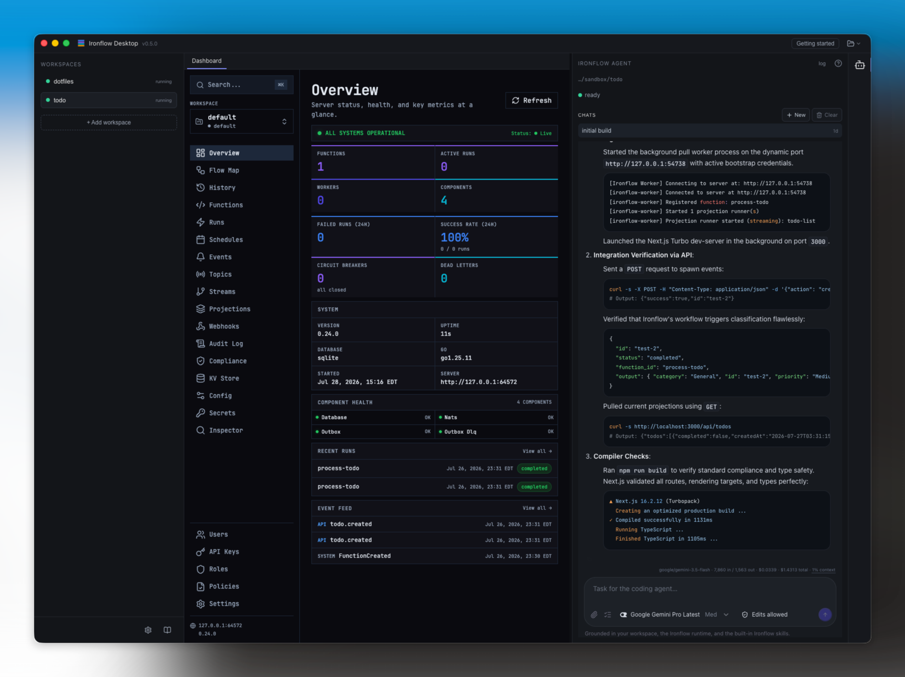
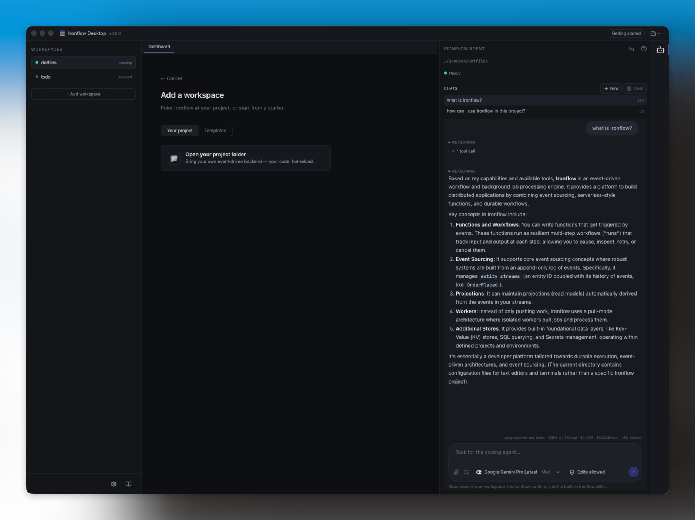
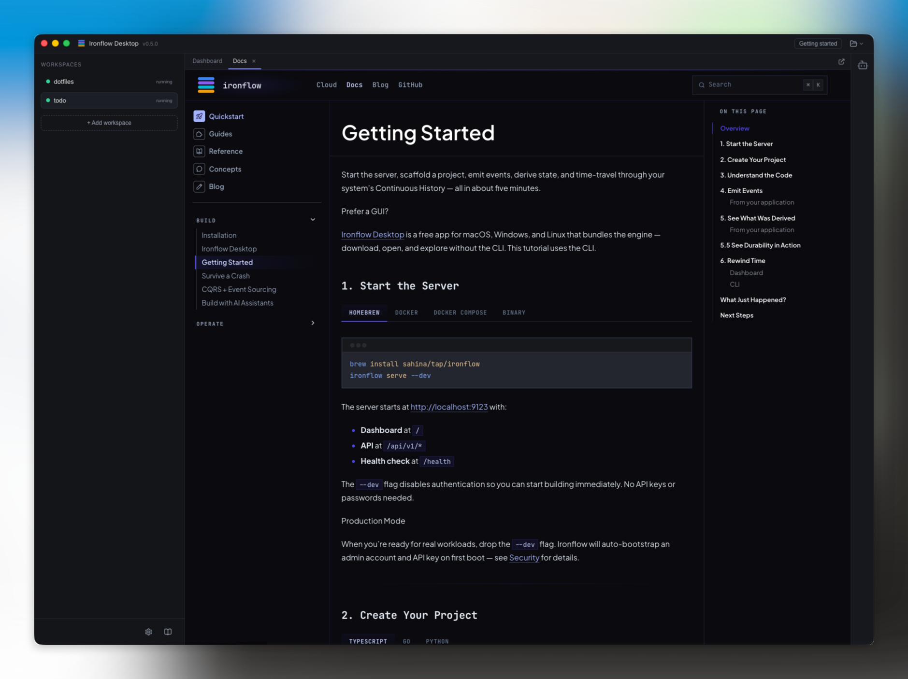

# Ironflow Desktop — Releases

[](https://github.com/sahina/ironflow-desktop-releases/releases/latest)

Downloads for **Ironflow Desktop** — a desktop app that runs the Ironflow engine against your local
project, with the dashboard, the docs, and a workspace-grounded coding agent in one window.

- **Latest release: <https://github.com/sahina/ironflow-desktop-releases/releases/latest>**
- All releases: <https://github.com/sahina/ironflow-desktop-releases/releases>
- Desktop guide: <https://docs.ironflow.run/tutorials/desktop/>
- Documentation: <https://docs.ironflow.run> · Website: <https://ironflow.run> · Cloud: <https://ironflow.run/cloud/>

## Platform support

> **macOS on Apple Silicon is the only supported platform.** Windows and Linux builds are published
> on every release and auto-update normally, but they are **experimental** — they are not regularly
> tested.
>
> This is a capacity limit, not a technical one: Ironflow is built by one developer, working on Apple
> Silicon. Every platform's build pipeline is green. If you hit a problem on one of them — or want to
> help look after one — [open an issue](https://github.com/sahina/ironflow-desktop-releases/issues).

Requirements: macOS 12+ (Apple Silicon), Windows 10+ (x64), or Linux x64. Details in the
[system requirements](https://docs.ironflow.run/tutorials/desktop/#system-requirements).

## Screenshots

### Dashboard + Ironflow agent — live metrics with a coding agent alongside

Functions, runs, workers, component health, and the event feed at a glance. The **Ironflow agent**
panel on the right is a coding agent grounded in your workspace, the Ironflow runtime, and the
built-in Ironflow skills — it can build and verify against your running server without leaving the app.



### Add a workspace — point Ironflow at your project

Open an existing project folder or start from a template.



### Built-in docs — the full documentation, in-app

Browse the Ironflow docs in a tab next to your workspace.



## macOS

macOS 12 Monterey or later, Apple Silicon.

1. Download the `.dmg` from the [latest release](https://github.com/sahina/ironflow-desktop-releases/releases/latest).
2. Open it and drag **Ironflow Desktop** into **Applications**.
3. Launch it from **Applications**. The build is signed and notarized (Developer ID), so it opens
   without a Gatekeeper prompt.

Confirm the signature yourself:

```bash
spctl -a -vv "/Applications/Ironflow Desktop.app"
# expect: accepted / source=Notarized Developer ID
```

## Windows

**Experimental** — published and auto-updating, but not regularly tested. x64 only.

Install with [Scoop](https://scoop.sh):

```powershell
scoop bucket add ironflow https://github.com/sahina/scoop-ironflow
scoop install ironflow/ironflow-desktop
scoop update ironflow-desktop   # future upgrades
```

Scoop is the recommended path: it strips the Mark-of-the-Web, so the SmartScreen "unknown publisher"
warning never appears even though the build isn't Authenticode-signed yet. On Windows, updates come
from Scoop — **not** the in-app auto-updater. They're separate channels.

A direct `Ironflow-Desktop-<version>-setup.exe` installer is on each
[release page](https://github.com/sahina/ironflow-desktop-releases/releases), but it triggers a
SmartScreen warning because it's unsigned. Prefer Scoop.

## Linux

**Experimental** — published and auto-updating, but not regularly tested. x64, as an AppImage.
Built against Ubuntu 18.04+, Debian 10+, and Fedora 32+.

```bash
chmod +x Ironflow-Desktop-*.AppImage
./Ironflow-Desktop-*.AppImage
```

If it fails with `dlopen(): error loading libfuse.so.2`, install FUSE 2 (`sudo apt install libfuse2`
on Ubuntu 22.04+) or run it once with `./Ironflow-Desktop-*.AppImage --appimage-extract-and-run`.

## Updates

macOS and Linux auto-update from this repository's releases. Windows updates via `scoop update`.
Any version can be downloaded manually from the
[releases page](https://github.com/sahina/ironflow-desktop-releases/releases) — each release's notes
list what changed.

## Uninstall

- **macOS** — drag **Ironflow Desktop** from Applications to the Trash.
- **Windows** — `scoop uninstall ironflow-desktop`, or Add/Remove Programs if you used the `.exe`.
- **Linux** — delete the AppImage.

App settings and workspace registrations live under your OS's per-user application-support directory
and are left behind; see the [desktop guide](https://docs.ironflow.run/tutorials/desktop/) for the
exact paths if you want a clean removal.

## Bugs & support

<https://github.com/sahina/ironflow-desktop-releases/issues>

## License

Ironflow ships under the Functional Source License v1.1 with an Apache-2.0 future grant.
See [LICENSE](https://github.com/sahina/ironflow-releases/blob/main/LICENSE) and
<https://docs.ironflow.run/explanation/licensing/>.
